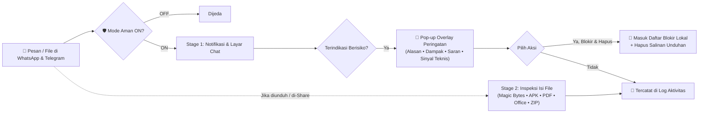

<div align="center">


# ChatGuard

**_"Aman dulu sebelum buka—deteksi file berbahaya secara pintar sebelum diunduh."_**

[](../../releases/tag/v1.2.0)
[](android/)
[](api/)
[](docs/privacy-policy.html)

[Download APK (v1.2.0)](../../releases/latest) • [Kebijakan Privasi](docs/privacy-policy.html) • [Arsitektur](#-cara-kerja-chatguard) • [Build Lokal](#-panduan-build-lokal)

</div>

---

## Kenapa ChatGuard?

Modus penipuan lewat WhatsApp dan Telegram (*undangan pernikahan `.apk`*, *resi kurir palsu*, *surat tilang PDF berbahaya*) sering menjebak korban karena **file langsung terunduh atau terbuka** sebelum pengguna sempat curiga.

**ChatGuard** memberi peringatan **sebelum file diunduh** langsung di atas layar chat, lengkap dengan penjelasan bahasa awam dan sinyal teknisnya.

---

## Alur Deteksi (Interaktif)



---

## Fitur Utama

<details open>
<summary><b>🛡️ 1. Mode Aman ON/OFF & Walkthrough Awal</b></summary>

- **Sakelar Mode Aman** langsung di Beranda untuk mengaktifkan atau menjeda pemantauan kapan saja.
- **Walkthrough interaktif 4 langkah** saat pertama kali membuka aplikasi, plus **Persetujuan Privasi** yang jelas.

</details>

<details>
<summary><b>💬 2. Deteksi Pra-Unduh (Notifikasi & Layar Chat)</b></summary>

- **Akses Notifikasi (`NotificationListenerService`):** Mendeteksi ekstensi ganda (`.pdf.apk`), skrip berbahaya (`.exe`, `.bat`, `.vbs`, `.js`), dan kata pancingan (*undangan, resi, tilang, tagihan, kurir, paket*).
- **Pantau Layar Chat (`AccessibilityService`, opsional):** Membaca nama dokumen yang tampil langsung di layar WhatsApp/Telegram tanpa menunggu notifikasi atau mengunduh file.
- **Anti-Spam *Scroll*:** *Cooldown* pintar **10 menit** per file agar pop-up tidak muncul berulang saat menggulir chat.

</details>

<details>
<summary><b>🚨 3. Pop-up Overlay Lengkap + Blokir & Hapus</b></summary>

- Menampilkan **Apa yang ditemukan**, **Dampak jika dibuka**, **Saran aman**, dan **Sinyal Teknis** (`LURE_KEYWORDS_ID`, `DOUBLE_EXTENSION_APK`, dll.).
- Tombol **`Ya, Blokir & Hapus`** menandai file ke daftar blokir lokal dan menghapus salinan fisik jika sudah terunduh di `Download` / `WhatsApp Documents`.

</details>

<details>
<summary><b>📚 4. Dashboard Log Aktivitas & Belajar Ancaman</b></summary>

- Statistik lokal (**Terdeteksi**, **Diblokir**, **Pola Lokal**).
- Setiap kartu aktivitas menampilkan **💡 Pelajaran untuk Anda** agar pengguna umum makin mengenali pola penipuan terbaru.

</details>

<details>
<summary><b>🔍 5. Inspeksi Isi File Lokal (Stage 2) & Mode Hybrid Opsional</b></summary>

- Memeriksa **Magic Bytes** (mendeteksi APK/ZIP yang menyamar jadi `.pdf`), izin berisiko di `AndroidManifest.xml`, `/JavaScript` & `/OpenAction` di PDF, macro Office, serta arsip ZIP/RAR.
- Dapat dihubungkan ke server **Hybrid Reputation API** (`api/`) secara opsional (hanya mengirim hash SHA-256 & metadata anonim).

</details>

---

## Komitmen Privasi

| Aspek | Status di ChatGuard |
| :--- | :--- |
| Akses Kontak, Galeri/Foto, Lokasi | **Tidak pernah diminta** |
| Menyimpan atau mengirim isi pesan chat | **Tidak pernah dilakukan** |
| Mengunggah isi dokumen pribadi | **Tidak pernah dilakukan** |
| Deteksi & pembelajaran pola ancaman | **100% lokal di perangkat** |

---

## Panduan Build Lokal

<details>
<summary><b>📱 Build Aplikasi Android (JDK 17 + Android SDK)</b></summary>

```powershell
cd android
.\gradlew.bat :app:testDebugUnitTest :app:assembleRelease
```
Output APK rilis: `android/app/build/outputs/apk/release/app-release.apk`

</details>

<details>
<summary><b>🌐 Jalankan Hybrid Reputation API (Opsional)</b></summary>

```powershell
cd api
pytest tests -v
uvicorn app.main:app --host 0.0.0.0 --port 8000
```

</details>
